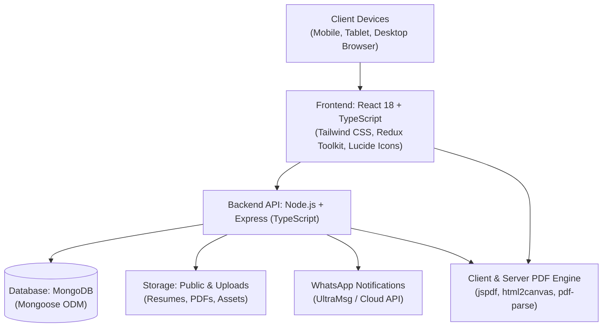
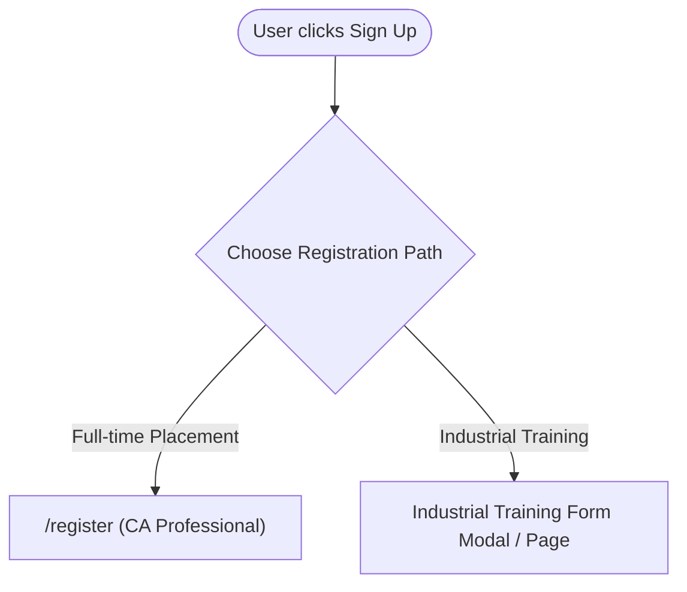
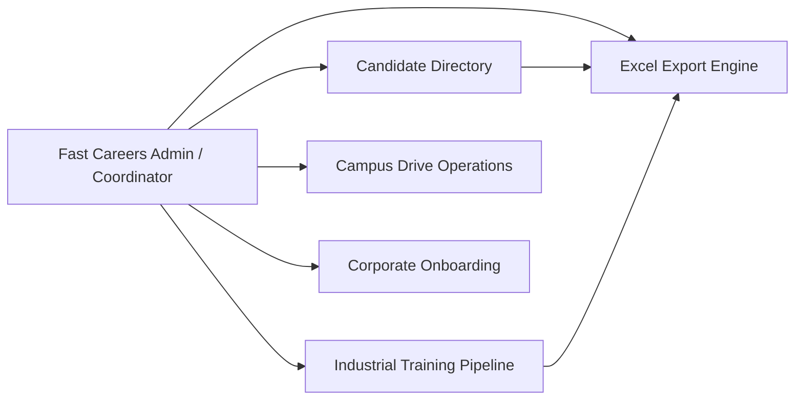

# FAST CAREERS — Complete Website & Platform Documentation

> **Fast Career Consultants Private Limited**  
> *India's Largest CA Placement & Industrial Training Network (Since 2008)*  
> Official Website: [fast-india.com](https://fast-india.com)

---

## Table of Contents
1. [Executive Summary & Platform Purpose](#1-executive-summary--platform-purpose)
2. [Technology Stack & System Architecture](#2-technology-stack--system-architecture)
3. [User Roles & Permissions](#3-user-roles--permissions)
4. [Public & Marketing Pages](#4-public--marketing-pages)
5. [Candidate Registration & Dual Pathways](#5-candidate-registration--dual-pathways)
6. [CA Industrial Training Module (ICAI Norms)](#6-ca-industrial-training-module-icai-norms)
7. [Candidate Dashboard & Self-Service Suite](#7-candidate-dashboard--self-service-suite)
8. [Employer Portal & Corporate Drives](#8-employer-portal--corporate-drives)
9. [Admin & Coordinator Management Portal](#9-admin--coordinator-management-portal)
10. [Excel Export & Database Schema Specifications](#10-excel-export--database-schema-specifications)
11. [Integrations, APIs & Automated Workflows](#11-integrations-apis--automated-workflows)

---

## 1. Executive Summary & Platform Purpose

**Fast Careers** is a specialized recruitment, placement, and training portal engineered specifically for the Chartered Accountancy (CA) ecosystem in India. Operating continuously since 2008, the platform bridges the gap between:
- **Chartered Accountants (Qualified & Experienced CAs)**
- **Semi-Qualified CAs & Freshers**
- **CA Inter / IPCC Students seeking Industrial Training**
- **500+ Corporate Recruiters, Big 4 Audit Firms, Investment Banks, and MNCs**

The website automates candidate intake, resume intelligence parsing, ICAI tenure verification, employer job postings, assessment tests, and Excel reporting for placement coordinators.

---

## 2. Technology Stack & System Architecture

### Frontend Architecture
- **Framework:** React 18 with TypeScript, bundled via Vite.
- **Styling:** Tailwind CSS with custom responsive utilities, fluid typography, and mobile-safe viewports.
- **State Management:** Redux Toolkit (`authSlice`, `jobSlice`, `applicationSlice`).
- **Icons & Graphics:** Lucide React icons, responsive animations.
- **Client Resume & Document Processing:** Client-side parsing fallback and client PDF generation via `html2canvas` & `jspdf`.

### Backend Architecture
- **Runtime:** Node.js with Express & TypeScript.
- **Database:** MongoDB with Mongoose ODM schemas for Users, Applications, Industrial Training, Jobs, and Assessments.
- **Authentication:** JWT (JSON Web Tokens) with secure password hashing (`bcryptjs`), role-based middleware (`protect`, `adminOnly`, `employerOnly`).
- **File Upload Engine:** `multer` supporting `.pdf`, `.doc`, `.docx` with secure file naming and static serving.
- **Parser Engine:** `pdf-parse` for automated field extraction from candidate CVs.
- **Third-Party Integrations:** UltraMsg WhatsApp Gateway for real-time submission alerts.

---

## 3. User Roles & Permissions

| Role | Access Level | Primary Capabilities |
| :--- | :--- | :--- |
| **Guest / Public** | Unauthenticated | Browse public site, view jobs, explore placement track record, use Sign-Up choice modal, register as Candidate or Employer, submit Industrial Training form. |
| **Candidate** | Authenticated Candidate | Manage profile, view matched job openings, apply to jobs, take Fast Selection assessment, generate standardized resume PDF, refer friends, request confidential job change. |
| **Employer** | Authenticated Corporate | Post jobs, manage listings, browse candidate database with filters (CTC, attempts, rankers, cities), review received applications, view billing/invoices. |
| **Admin** | Super Administrator | Complete access to all candidates, Industrial Training submissions, company onboarding, coordinator management, job postings, test results, and master Excel data export. |
| **Employee / Coordinator** | Operational Staff | Manage candidate pipelines, review applications, conduct drive operations, update candidate interview stages. |

---

## 4. Public & Marketing Pages

1. **Home (`/`):**
   - High-impact hero section with live stats (18+ Years, 125,000+ CAs, 60+ top corporate partners).
   - Recruiter Marquee with continuous animation displaying leading hiring partners (Big 4s, Top MNCs).
   - Placement Journey Timeline (2008 Indore inception $\to$ 2010 Delhi NCR $\to$ 2012 Metro expansion $\to$ 2020+ Virtual pan-India drives).
   - Executive Leadership Showcase.
   - Dual-action registration triggers (`Register as CA Candidate` & `Industrial Training Fill Form`).

2. **About Us (`/about`):**
   - Detailed story of Fast Careers, mission, corporate vision, and milestones since 2008.

3. **CA Campus & Team (`/ca-campus`, `/our-team`):**
   - Information about physical and virtual campus placement drives and leadership team.

4. **Services (`/services`):**
   - Comprehensive breakdown of services for Candidates (Off-Campus, Lateral hiring, Mock interviews) and Corporates (Turnkey drives, Executive search, Industrial training placement).

5. **Expertise (`/expertise`):**
   - Domain-specific recruitment strengths: Statutory Audit, Internal Audit, Direct & Indirect Tax, FP&A, Investment Banking, Management Consulting.

6. **Employers Portal (`/employers`):**
   - Dedicated landing page for corporate HRs, talent acquisition leads, and partners to partner with Fast Careers for hiring.

7. **Job Listings & Details (`/jobs`, `/jobs/:id`):**
   - Publicly searchable job board with filters for experience level, location, and functional domain.
   - 1-click apply integration with candidate profile data.

8. **Contact Us (`/contact`):**
   - Contact form, corporate headquarters address, direct telephone and email contacts, interactive inquiry submission.

9. **Placement Results & Hall of Fame (`/ca-placements`, `/placement-results`):**
   - Verified candidate selection lists, hiring firm highlights, and historical drive outcomes.

---

## 5. Candidate Registration & Dual Pathways

### Sign-Up Choice Modal (`SignUpChoiceModal.tsx`)
When a user clicks "Sign Up" anywhere on the site, a responsive, scrollable choice modal presents two clear paths:
1. **CA Professional Registration Form:** For Qualified CAs, Semi-Qualified, and Freshers seeking full-time corporate placements.
2. **CA Industrial Training Form:** For CA Inter students seeking 9–15 months articleship/training at Big 4s and MNCs.

### Full Registration Features (`/register` — `Register.tsx`)
- **1-Click AI Resume Scanner:**
  - Candidate drops/uploads PDF or DOCX resume.
  - Server and client extract Name, Email, Phone, Primary City, LinkedIn URL, CA Inter/Final details, and Work Experience.
  - Automatic form pre-fill saves over 80% of manual entry time.
- **Personal Details:**
  - First Name, Last Name, Email (with instant uniqueness verification), Mobile Number (10 digits).
  - 4-Digit Security PIN / Password.
  - Date of Birth via 3 responsive dropdowns (Day, Month, Year).
  - Primary City with searchable dropdown covering 8 core metropolitan hubs + custom other input.
  - Optional LinkedIn URL.
- **Academic Qualifications (Positioned above Career Stage):**
  - **Graduation Status:** Responsive 3-button toggle (`Completed` | `Pursuing` | `Not Pursuing`).
    - When *Not Pursuing*: Highlights Direct CA entry / Foundation route; suppresses unnecessary fields.
    - When *Completed* or *Pursuing*: Captures Degree (`B.Com`, `BBA`, `BAF`, `BBI`, etc.), College Name (with autocomplete datalist), Degree Mode (`Regular` vs `Distance/Open`), Passing Year, and Percentage/CGPA.
  - **Class XII:** Percentage, Passing Year, Board (`CBSE`, `ICSE`, `State Board`).
  - **Class X:** Percentage, Passing Year, Board (`CBSE`, `ICSE`, `State Board`).
- **Career Stage Split:**
  - **Fresher / Semi-CA Card:**
    - Expands dynamic Articleship Details (Firm name, partner count, city, duration, completion month/year, nature of work: Statutory Audit, Internal Audit, Taxation, etc.).
    - Multiple articleship firms can be added or removed dynamically.
    - GMCS completion, listed company audit experience, Big 6 articleship status.
    - CA Final percentage validation (strictly enforced between 50% and 100%).
  - **Experienced CA Card (2+ Years Required):**
    - CA Final Year of Completion (1970 to Present).
    - Total Work Experience (dropdown starting from 2+ Years up to 10+ Years).
    - Current Company Name & Designation.
    - Current CTC (LPA) & Expected CTC (LPA) (allows free decimal input, e.g. `12.5`).
    - Notice Period (`Immediate`, `15 Days`, `30 Days`, `60 Days`, `90 Days`).
    - Work Profile description.
- **CA Intermediate Credentials:**
  - Both Groups in 1st Attempt (`Yes` / `No`).
  - When `Yes`: Automatically sets Group 1 and Group 2 attempts to `1`.
  - When `No`: Opens separate dropdowns with full range **1 to 50 attempts** for Group 1 and Group 2.
  - CA Inter Exam Sessions and Ranker status (`No Rank` or Rank `1`–`50`).
- **CA Final Credentials (for Qualified CAs):**
  - Both Groups in 1st Attempt (`Yes` / `No`).
  - Group 1 and Group 2 attempts (1 to 50).
  - Completion Session (Month & Year) formatted as `Mon-YY` (e.g. `Nov-25`).
  - All India Rank (AIR) capture.
- **Preferred Job Locations:**
  - Multi-select dropdowns restricted to primary metro corporate hubs:
    1. *Mumbai*
    2. *Delhi NCR*
    3. *Bengaluru*
    4. *Hyderabad*
    5. *Chennai*
    6. *Kolkata*
    7. *Pune*
    8. *Ahmedabad*

---

## 6. CA Industrial Training Module (ICAI Norms)

Accessible through both `/industrial-training` and the interactive modal `IndustrialTrainingModal.tsx`.

### Core Requirements & Business Logic
- **ICAI Eligibility Compliance:** Trainees must have passed both groups of CA Intermediate and have completed between **9 to 15 months** of articleship.
- **Credentials Validation:**
  - `CA Both Groups in 1st Attempt?`:
    - If `Yes`: Locks Group 1 and Group 2 attempts to `1` (displays `1` with `Locked (1st Attempt)` badge).
    - If `No`: Opens dropdowns allowing candidate to select attempt count from **1 to 50** for each group.
  - CA Inter Passing Batch / Month (e.g. `Nov 2023`, `May 2024`, etc.).
  - CA Inter Rank (No Rank or Rank 1 to 50).
- **Articleship Tenure & Firm Data:**
  - Current Articleship Firm Name.
  - Articleship Start Month & Year (used to compute 9–15 months tenure).
  - Big 6 firm exposure indicator.
  - Preferred Training Locations (Ahmedabad, Mumbai, Delhi NCR, etc.).
  - Preferred Industry Sectors (Investment Banking, Big 4 Audit, Management Consulting, Manufacturing, FMCG, Tech).
- **ICAI Verification Declaration:**
  - Candidate confirms authenticity under ICAI verification rules.
- **Automated Workflow upon Submission:**
  1. Generates unique Application Reference ID (e.g. `FAST-IT-ABC123`).
  2. Creates or links the candidate profile in the main database.
  3. Triggers real-time WhatsApp confirmation notification to candidate.
  4. Appears instantly in Admin Industrial Training pipeline.

---

## 7. Candidate Dashboard & Self-Service Suite

Once logged in, candidates access a dedicated portal (`/candidate/dashboard`):

1. **Dashboard Overview (`/candidate/dashboard`):**
   - Profile completion score meter.
   - Status of submitted applications (Under Review, Shortlisted, Interview Scheduled, Offered).
   - Fast Selection assessment status badge.
2. **Fast Selection Assessment Test (`/candidate/fast-selection`):**
   - Timed multiple-choice screening test covering Accounting Standards, Ind AS, Direct & Indirect Tax, Auditing, and Corporate Finance.
   - Real-time score recording for recruiters to filter top-scoring candidates.
3. **Resume Print & PDF Generator (`/candidate/resume-print`, `/candidate/resume-downloads`):**
   - Standardized, publication-grade Fast Careers CA resume template.
   - 1-click browser print or PDF download without requiring third-party resume builders.
4. **Current Openings & Job Fair (`/candidate/openings`, `/candidate/job-fair`):**
   - Curated list of active jobs matching candidate eligibility.
   - Virtual campus drive halls and scheduled drive details.
5. **Confidential Job Change Service (`/candidate/change-job`):**
   - Discretionary portal for working CAs to request confidential off-market corporate interviews without alerting current employers.
6. **Important Downloads (`/candidate/imp-downloads`):**
   - Repository of interview preparation guides, Big 4 case studies, and ICAI orientation checklists.
7. **Referral Program (`/candidate/refer`):**
   - Referral tracking mechanism where CAs can invite batchmates and track placement milestones.

---

## 8. Employer Portal & Corporate Drives

Accessible by corporate recruiters and HR heads (`/employer/*`):

1. **Employer Dashboard (`/employer/dashboard`):**
   - Overview of active job openings, total candidate applications, and shortlisted talent.
2. **Job Postings Management (`/employer/jobs`):**
   - Form to create new job requisitions: Role title, experience range, minimum attempts allowed, ranker preference, CTC brackets, work location, job description.
   - Publish, pause, or archive job postings.
3. **Candidate Search & Filter Engine (`/employer/candidates`):**
   - Search the 125,000+ candidate database.
   - Filter by:
     - Qualification: Qualified CA vs Semi-CA vs Industrial Trainee.
     - Experience: Fresher vs 2–5 yrs vs 5+ yrs.
     - Attempts: 1st Attempt only, $\le 2$ attempts, etc.
     - Rankers: All India Rankers (AIR 1–50).
     - Preferred or Current City.
4. **Application Pipeline (`/employer/applications`):**
   - Kanban-style or tabular applicant tracking (New $\to$ Screened $\to$ Shortlisted $\to$ Interview $\to$ Selected $\to$ Rejected).
   - Direct download of candidate CV and Fast Careers scorecards.

---

## 9. Admin & Coordinator Management Portal

Comprehensive administrative backend (`/admin/*`) for Fast Careers operations:

1. **Master Candidate Directory (`/admin/candidates`):**
   - Unified searchable directory of all registered candidates.
   - Filter by Fresher vs Experienced, qualification year, attempts, city, and status.
   - Inline status updates (Verified, Under Review, Placed).
2. **Industrial Training Pipeline (`/admin/industrial-training`):**
   - Exclusively tracks CA Industrial Training applicants.
   - Displays ICAI eligibility badge, 9–15 months tenure verification, and attempts.
   - Direct referral assignment to partner Big 4s and investment banks.
3. **Platform Analytics & Test Results (`/admin/test-results`):**
   - Score reports from candidate Fast Selection tests.
4. **Corporate Partner Onboarding (`/admin/add-company`):**
   - Add new recruiters, specify billing terms, set allocated candidate quotas.
5. **Coordinator / Staff Accounts (`/admin/add-employee`):**
   - Create and manage role-based staff logins for placement coordinators.

---

## 10. Excel Export & Database Schema Specifications

The platform includes an enterprise-grade Excel export engine (`excelExportHelper.ts`) tailored for corporate recruiting teams.

### Standardized Excel Column Mapping
When administrators export candidates, the columns match corporate audit specifications:

| Column Header | Source / Description | Format Example |
| :--- | :--- | :--- |
| `Name` | Candidate full name | `Rahul Sharma` |
| `EmailID` | Primary email address | `rahul@ca.org.in` |
| `MobNo` | 10-digit mobile number | `9876543210` |
| `CurCity` / `CurState` | Current residence city and state | `Indore`, `Madhya Pradesh` |
| `PerCity` / `PerState` | Permanent location | `Indore`, `Madhya Pradesh` |
| `DOB` | Formatted date of birth | `15-08-1998` |
| `Gender` | Candidate gender | `Male` / `Female` |
| `IsCAFinalBothGrpIn1stAtt` | Cleared both CA Final groups in 1st attempt | `Yes` / `No` |
| `CAFinalG1_AttNos` | Numeric count of attempts for Group 1 | `1`, `2`, `3` |
| `CAFinalG2_AttNos` | Numeric count of attempts for Group 2 | `1`, `2`, `3` |
| `CAFinal_IsRanker` | All India Rank status | `AIR 42` or `No` |
| `CAFinalSession` | Completion month and 2-digit year | `Nov-25`, `May-24` |
| `IsCAInterBothGrpIn1stAtt` | Cleared both CA Inter groups in 1st attempt | `Yes` / `No` |
| `CAInterG1_AttNos` | Numeric count of CA Inter Group 1 attempts | `1`, `2`, ... `50` |
| `CAInterG2_AttNos` | Numeric count of CA Inter Group 2 attempts | `1`, `2`, ... `50` |
| `CAInterSession` | CA Inter passing month and 2-digit year | `Nov-23`, `May-22` |
| `ArtFirmName_1` | Primary articleship firm name | `Deloitte Haskins & Sells` |
| `ArtFirmCity_1` | Primary articleship firm location | `Mumbai` |
| `ArtNoOfPartners_1` | Number of partners in articleship firm | `15` |
| `IsFresher` | Career stage classification | `Yes` (Fresher) / `No` (Exp) |
| `CurOrg` | Current employer (for experienced candidates) | `PwC India` |
| `CurOrgCtc` | Current annual package | `14.5 LPA` |
| `CurOrgNoticePeriod` | Official notice period | `30 Days` |

---

## 11. Integrations, APIs & Automated Workflows

1. **Resume Intelligence Parsing:**
   - Multi-layer regex and natural language scanner extracts candidate credentials from uploaded PDF and DOCX files.
   - Parses complex CA credentials (IPCC/Inter groups, attempts, passing year, articleship firms).

2. **WhatsApp Automation Gateway:**
   - Integrated with UltraMsg REST API.
   - Sends real-time WhatsApp confirmations to candidates on registration and Industrial Training submission.
   - Provides candidates with their Reference ID and next steps.

3. **Client-Side Security & Validation:**
   - Email format and uniqueness check.
   - 10-digit phone verification.
   - 4-digit security PIN enforcement.
   - Mandatory field validation preventing blank submission.
   - CA Final percentage strict boundary validation ($50\% \le \text{Percentage} \le 100\%$).

4. **Mobile & Viewport Optimizations:**
   - 100% responsive across mobile (360px, 375px, 390px, 414px), tablet (768px), and desktop (1024px, 1280px, 1920px).
   - Global protection against horizontal overflow (`overflow-x: hidden`, `max-width: 100vw`).
   - Modal vertical containment (`max-h-[92vh]`, `my-auto`, `overflow-y-auto`) guaranteeing no cut-off headers or hidden buttons on mobile browsers.

---
*Documentation compiled for Fast Career Consultants Private Limited.*
